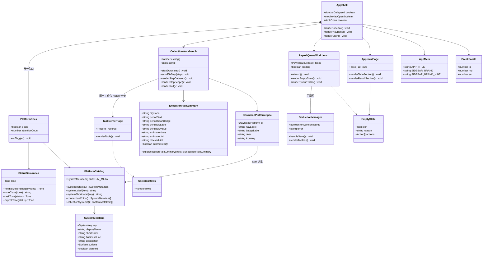
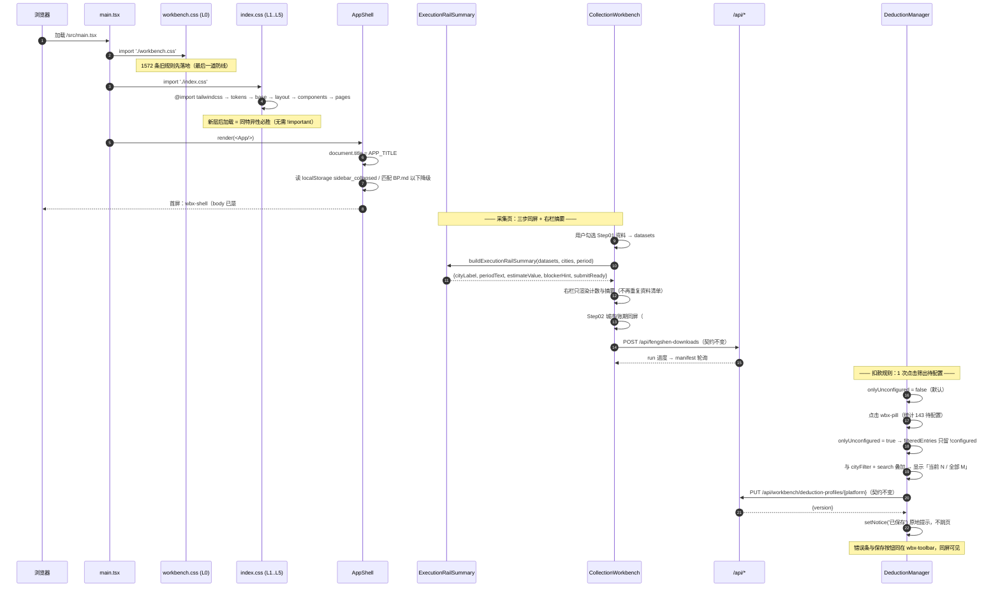
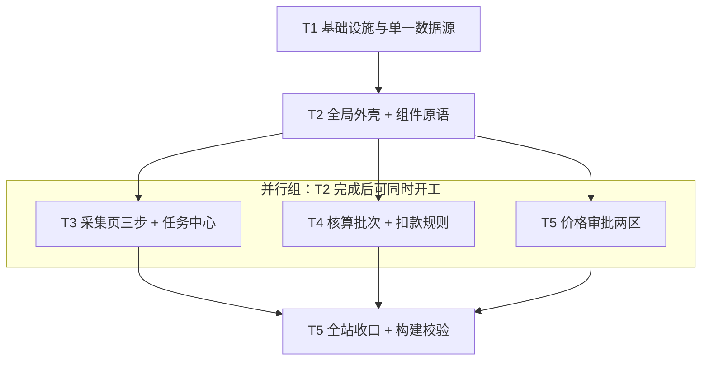

# 01 增量架构设计：页面流程优化与视觉翻新

- 文档类型：增量架构设计 + 任务分解（**本轮只设计，不改代码**）
- 上游输入：`docs/ui-rework/00-prd.md`（v0.1，P0 九项，V1–V24）
- 项目根：`D:\工作文件\兼职运力与薪资结算调度中心`
- 技术栈实测：Vite 8.3 + React 19.0 + TypeScript 7 + Tailwind 4.3（`@tailwindcss/vite`）+ 44 个自研组件
- 约束基线（不可推翻）：D1–D8（平台字典不合并 key / 标题统一 / index.html 可改 / 允许 manualChunks / 不重发校验清单 / 只做 1280·1024·768 三档 / 新层 0 个 `!important` + `index.css` ≤150 / 零后端改动）

---

## 0. 现状基线与本文所有数字的来源

本节所有数字均为**实测**（非 PRD 引用），用于工程师自检与验收比对。

| 项 | 实测值 | 命令 |
| --- | --- | --- |
| `src/index.css` | 2608 行 / 55,029 B / **320** 个 `!important` | `grep -c "!important" src/index.css` |
| `src/index.css` 断点 | 8 处：1100 / 1240 / 960 / 900 / 760 / 720 / 640×2 / 560 | `grep -o "@media[^{]*" src/index.css \| sort -u` |
| `src/workbench.css` | 140,790 B **单行压缩** / 1572 条规则 / **21** 个 `!important` | `grep -o "!important" src/workbench.css \| wc -l` |
| `src/workbench.css` 断点 | 12 组：420 / 480 / 600×2 / 700×6 / 760×4 / 800×2 / 1000 / 1023 / 1100×2 / 1180 / `width>=1024` / `prefers-reduced-motion` | 同上 |
| `src/workbench-unified.css` | 1 行注释，**0 条规则** | — |
| CSS 加载顺序（当前） | `main.tsx` 先 import `App.tsx`（其内部 import workbench.css → workbench-unified.css），再 import `index.css` → **index.css 最后生效** | 读源码 + 覆盖效果反推 |
| 全局动画杀手 | `workbench.css` 首段 `.workbench-app,.workbench-app *,.workbench-app :before,.workbench-app :after{...animation:none!important}` | `grep -o ".\{0,60\}animation:none.\{0,60\}"` |
| 已存在的 reduced-motion 兜底 | `@media (prefers-reduced-motion:reduce){.workbench-app *{transition-duration:.01ms!important;animation-duration:.01ms!important}}` —— **P0-6 无障碍要求已被满足，只需删全局杀手** | 同上 |
| 输入框字号锁死 | `input:not(...),select,textarea{font-size:16px!important}`（workbench.css）→ 阻止 13px 控件字号 | 同上 |
| `!important` 热点（index.css 前 8 个选择器） | `.wb-task-preview.wb-preview-compact`(18) / `.wb-compact-clear-btn`(17) / `.wb-template-item > div:last-child .wb-error`(12) / `...rail-bottom`(12) / `...rail-top`(10) / `.wb-error-login-btn`(10) / `.wb-dataset-category-bar`(10) / `.wb-template-toolbar`(9) | `awk` 统计 |
| `!important` 分节分布 | §21 发薪平台 130 / §9 审批·任务中心 29 / §6 右栏 24 / §10 ReportBuilder 23 / §4 头部按钮 22 / §3 城市网格 18 / §8 跨模块 12 / §11 侧栏 12 / §15 预设 10 / §5 数据集卡 9 / §2 步骤卡 8 / §1 去嵌 6 / §7 白泽条 5 / §18 脉冲 5 / §12 城市预设 4 / §14 弹层 3 | `awk` 按 `/* N.` 分节 |
| 平台 key 事实 | `xiaoxiang`（采集通道）、`dengta`（`PayrollPreparation.tsx` 手动上传）确为两个 key；`SYSTEM_META` 6 条 | `grep 灯塔` |
| 平台名称散落点 | `workbench.ts`(29 处)/`FengshenDownloadCenter.tsx`(11)/`downloadModules.ts`(3)/`PayrollPreparation.tsx`(2)/`App.tsx`(2)/`SystemConnections.tsx`(1)/`DownloadRecords.tsx`(1)/`DeductionStationPicker.tsx`(1)/`CollectionScope.tsx`(1)/`DataReadinessMatrix.tsx`(1) | `grep -rc 灯塔 src` |
| 采集页 Step 锚点 | `#step-03-datasets`(=选择资料, L1590/L1723)、`#step-01-cities`(L1970)、账期 `fieldset`(L2338, **无 id**)、`scrollToStep` 硬编码映射(L402–404) | `grep -n 'id="step-'` |
| 右栏 | `<aside className="wb-task-preview wb-preview-compact">` L2570；重复清单 L2595–2664；范围核对 L2668–2701；开始按钮 L2703–2726 | 读源码 |
| 两栏栅格 | `.wb-download-workbench{grid-template-columns:minmax(0,1fr) 334px;background:#f8fafc!important}` | 同上 |
| 核算轮询 | `setInterval(() => void refresh(), 2500)` @ `PayrollQueueWorkbench.tsx:91`，无 `visibilityState` 判断 | 读源码 |
| 服务端口 | `APP_PORT` 可配（`server.ts:127`），`backendPort` 固定 8009 | `grep PORT server.ts` |
| 任务记录**无创建人字段** | `DownloadRecords` / `server.ts` 均无 `created_by` | `grep created_by` 为空 |

---

# Part A：系统设计

## 1. 目标架构

### 1.1 CSS 分层模型（五层 + 兼容层）

| 层 | 文件 | 职责边界 | 允许依赖 | 预估行数 | 硬上限 |
| --- | --- | --- | --- | --- | --- |
| L0 兼容（只读） | `src/workbench.css`（**不重写、不新增规则**） | 1572 条历史 `wb-*` 基础样式；仅允许 2 处外科手术（见 3.6） | 无 | 现有 | 只减不增 |
| L1 令牌 | `src/styles/tokens.css` | `--wbx-*` 变量全集 + 旧 `--wb-*` 变量桥接（bridge） | 无 | ~130 | 400 |
| L2 基底 | `src/styles/base.css` | 排版基座、`wbx-spin` 关键帧、`prefers-reduced-motion`、focus-visible、滚动条、`.wbx-visually-hidden` | L1 | ~150 | 400 |
| L3 布局 | `src/styles/layout.css` | 外壳栅格（`wbx-shell/sidebar/viewport/header/main/page`）、三档断点、抽屉与遮罩 | L1–L2 | ~280 | 400 |
| L4 组件 | `src/styles/components.css` | 可复用原语：`wbx-card` `wbx-btn` `wbx-pill` `wbx-tabs` `wbx-toolbar` `wbx-table` `wbx-empty` `wbx-skeleton` `wbx-field` `wbx-scroll` | L1–L3 | ~340 | 400 |
| L5 页面 | `src/styles/pages.css`（@import 清单 + 跨页规则）+ `src/styles/pages/collection.css` `payroll.css` `approval.css` | 只放"某个页面才成立"的组合规则；禁止出现新的原语 | L1–L4 | 40 / 260 / 200 / 110 | 400 每文件 |
| 迁移中残留 | `src/index.css` | 逐批搬空的旧覆盖层；文件首行保留 `@import "tailwindcss";` + 五层 `@import` | **只能引用 L1–L5 已定义的类** | 2608 → ~1200 | `!important` ≤150 |

**关键架构决策 1：不用 `@layer`，用显式 import 顺序。**
原因：`workbench.css` 与 `index.css` 的内容均不在任何 cascade layer 中，而**无层样式恒胜于有层样式**。若把新层放进 `@layer`，`workbench.css` 会反过来压制新层，反而被迫写 `!important`（违反 D7）。因此采用纯加载顺序级联。

**关键架构决策 2：CSS 只从 `main.tsx` 一处进入，顺序显式可读。**

```ts
// src/main.tsx （改造后，唯一 CSS 入口）
import {createRoot} from 'react-dom/client';
import App from './App.tsx';
import './workbench.css';   // L0 兼容层：必须最先（只读）
import './index.css';       // 入口：@import tailwindcss → L1..L5 → 旧覆盖规则
```
```css
/* src/index.css 第 1–7 行（改造后） */
@import "tailwindcss";
@import "./styles/tokens.css";
@import "./styles/base.css";
@import "./styles/layout.css";
@import "./styles/components.css";
@import "./styles/pages.css";
/* ↓ 以下是逐批搬空的旧覆盖层，禁止新增规则 */
```
同时**删除** `App.tsx:37-38` 的两行 CSS import，把 `src/workbench-unified.css` 内容改为一行弃用说明（`/* deprecated → src/styles/* */`）。

级联顺序证明（为什么新层能赢，且不需要 `!important`）：

| 场景 | 旧规则 | 新规则 | 结果 |
| --- | --- | --- | --- |
| workbench.css 普通规则（1551 条） | `.wb-step-card{border-radius:14px}` (0,1,0) | `.wbx-step{border-radius:var(--wbx-r-md)}` (0,1,0) | 新层后加载 → **新层胜** |
| workbench.css 的 21 条 `!important` | `input{font-size:16px!important}` 等 | 任何声明 | 新层**不能**胜 → 逐条处理（见 3.6，仅 3 条必须动） |
| index.css 的 320 条 `!important` | `.wb-approval-card{padding:18px 20px!important}` | `.wbx-card{padding:var(--wbx-s4)}` | 先删旧规则再上 `wbx-*` 类 → **新层胜**（不删旧的就永远输，这是迁移顺序的硬约束） |
| 新层内部 | — | 同级选择器 | `pages` > `components` > `layout` > `base` > `tokens` |

> **硬约束（写给工程师）**：任何"想改某个属性"的需求，先 `grep` 该属性是否被 `index.css` 的 `!important` 锁住。锁住的，**先迁移删除再加新规则**，绝不允许在新层写 `!important` 对抗。

**关键架构决策 3：重建区域换新前缀 `wbx-`，而非给旧类加样式。**
外壳（`wb-shell/wb-sidebar/wb-header/wb-main`）与采集页两栏（`wb-download-workbench/wb-task-preview`）会被 JSX 重写成 `wbx-*`。这样这些元素**完全脱离 1572 条旧规则**，样式行为 100% 可预测，且不再需要任何 `!important`。业务组件内部（表格、弹层、表单）继续用旧 `wb-*`，由 L5 页面层逐步接管。

### 1.2 命名约定

| 约定 | 规则 | 示例 |
| --- | --- | --- |
| 前缀 | 新层一律 `wbx-`；`wb-` 视为遗产，禁止在新 JSX 新增 | `wbx-card` |
| BEM | `wbx-block__element--modifier`，块名不与元素混用 | `wbx-card__header`、`wbx-btn--primary`、`wbx-rail__row` |
| 语义色 | 只用 tone 修饰符，**不写颜色词** | `wbx-pill--success/warn/danger/progress/neutral` |
| 组件状态 | `is-*` 仅表达交互态 | `is-active`（选中）、`is-open`、`is-collapsed`、`is-dragging` |
| 结构状态 | 用 `data-*` 属性，便于 CSS+JS 同源 | `data-sidebar="expanded\|collapsed"`、`data-density="compact"`、`data-state="ready"` |
| 禁止 | 新层出现 `!important`、`#hex` 裸值（除 tokens）、`@media` 非 1280/1024/768、行内 `style={{color}}` | — |

### 1.3 组件分层

| 层 | 定义 | 现有/新增 | 规则 |
| --- | --- | --- | --- |
| **页面壳（Shell）** | 决定"我在哪、能去哪"；不承载业务数据 | `App.tsx`（重构）、`PlatformDock.tsx`（新） | 只读导航与计数；不 fetch 业务数据；只有 1 个导航带 |
| **业务容器（Container）** | 持有页面级 state 与 API 调用 | `FengshenDownloadCenter.tsx`、`PayrollQueueWorkbench.tsx`、`StationDeductionManager.tsx`、`LanorangeApprovals.tsx`、`DownloadRecords.tsx` | 允许长文件（现状 3142 行）；**只允许 2 层可视容器**（`wbx-page` + `wbx-card`） |
| **展示组件（Presentational）** | 无副作用、可单测 | `EmptyState.tsx`（新）、`SkeletonRows.tsx`（新）、`TaskOutcome.tsx`、`ApprovalScopeFilters.tsx`、`PayrollReviewSummary.tsx` | 入参出参皆为 props；样式只消费 `components.css` |
| **数据/常量层（lib）** | 单一事实来源 | `appMeta.ts`（新）、`platformCatalog.ts`（新）、`statusSemantics.ts`（新）、`breakpoints.ts`（新）、`workbench.ts`（改） | 纯函数，无 DOM；被 UI 单向依赖 |

### 1.4 单一数据源清单

| 事实 | 唯一来源 | 派生 API | 必须改为派生的消费点 |
| --- | --- | --- | --- |
| 应用标题 | `src/lib/appMeta.ts` → `APP_TITLE = '兼职运力与薪资结算调度中心'` | `APP_TITLE` | `App.tsx:117 document.title`、`index.html:6 <title>`、`index.html:8 og:title` |
| 侧栏品牌 | 同上 `SIDEBAR_BRAND='薪酬结算中心'`、`SIDEBAR_BRAND_HINT='多平台数据采集与自动化核算'` | 常量 | `App.tsx:1040-1041` |
| 平台字典（6 键） | `src/lib/platformCatalog.ts` → `SYSTEM_META` | `systemMeta(key)`、`systemLabel(key)`、`systemShortLabel(key)`、`collectionSystems()`、`connectionChips()` | `workbench.ts:43,49-56,724,733-739`、`SystemConnections.tsx:46-52`、`downloadModules.ts:41-46`、`DownloadRecords.tsx:30`、`DeductionStationPicker.tsx:52`、`PayrollPreparation.tsx:108,193`、`FengshenDownloadCenter.tsx:2602-2609` |
| 采集平台（4 卡） | `downloadModules.ts` → `DOWNLOAD_PLATFORMS`（id 保持 `fengshen/lanorange/payout/xiaoxiang`，label 从 `SYSTEM_META` 派生，`payout` 为合成项） | `DOWNLOAD_PLATFORMS` | `FengshenDownloadCenter.tsx:1504-1541,2670,2676`、`workbench.ts:589-594` |
| 状态语义（5 tone） | `src/lib/statusSemantics.ts` → `Tone`、`toneClass()`、`normalizeTone()` | `taskTone(status)`、`payrollTone(status)`、`connectionTone(state)` | `PayrollQueueWorkbench.tsx:34,157`、`DownloadRecords.tsx:128`、`SystemConnections.tsx:371`、`App.tsx:1109` |
| 断点（3 档） | `src/lib/breakpoints.ts` → `BP={lg:1280,md:1024,sm:768}` | `matchMedia` 封装 | `App.tsx`（侧栏自适应）、CSS 内注释标注 |
| 右栏摘要 | `workbench.ts` → `buildExecutionRailSummary()`（**新增** `estimateCount/estimateUnit`） | 函数 | `FengshenDownloadCenter.tsx:1414,2680-2701` |

平台命名口径（D1 落地，**不合并 key**）：

| key | `displayName`（列表/卡/弹层） | `shortName`（≤4 字徽标/状态灯） | `surface` | 说明 |
| --- | --- | --- | --- | --- |
| `fengshen` | 风神 | 风神 | collection | — |
| `lanorange` | 蓝橙 | 蓝橙 | collection | 原雷神 |
| `baize` | 商翼 | 商翼 | collection | — |
| `benlai` | 本来人力 | 本来 | collection | — |
| `xiaoxiang` | **小象灯塔** | **灯塔** | collection | 采集通道（美团灯塔看板） |
| `dengta` | **灯塔（手动上传）** | 灯塔手动 | payroll | 只用于薪资核算手动上传分支 |

> `shortName='灯塔'` 在全站唯一（`dengta` 不出现在任何采集列表/状态灯/表格里），故 V3「无两个灯塔」成立。`workbench.ts:1214-1216` 的 `.replaceAll('小象灯塔','灯塔')` 保留（它就是"长名→短名"的实现），但改为调用 `systemShortLabel('xiaoxiang')`。

---

## 2. Mermaid 模型

（另存为 `docs/class-diagram.mermaid` 与 `docs/sequence-diagram.mermaid`）

### 2.1 类图：数据源 + 组件分层



### 2.2 时序图：样式层生效 + 采集页主路径 + 扣款筛选保存



---

## 3. 迁移策略

### 3.1 三阶段路线

| 阶段 | 内容 | 出口判据（可执行） |
| --- | --- | --- |
| P0 快照 | zip `src/` + `index.html` + `vite.config.ts` + `package.json` → `docs/ui-rework/_backup-<date>.zip`；记录 `!important` 基线 | 快照存在 + `npm run lint` 通过 + `npm run build` 成功 |
| P1 建层（T1） | 建 L1–L5 文件、改 CSS 入口、删动画杀手、建 4 个 lib、改 index.html/vite.config | `grep -c "animation:none" src/*.css`=0；`grep -c "!important" src/styles/*.css`=0；`npm run build` 产出 vendor chunk |
| P2 换壳（T2） | 外壳换 `wbx-*`，删 `wb-mobile-nav`，状态灯/通知合并入口 | 1024/768/375 三档截图导航只有一套；无横向溢出 |
| P3 逐页换装（T3/T4/T5） | 每页：先在该页 JSX 换 `wbx-*` → 再写 L5 规则 → **最后删 index.css 对应块** | 每页 V 项通过 + `grep -c "!important" src/index.css` 单调下降 |

### 3.2 `workbench.css` 作为只读兼容层的退出路径

它不是"删掉"，而是"逐元素脱钩"，四步：

1. **隔离**：文件只在 `main.tsx` import 一次（移除 `App.tsx` 的 import），保证它是第一道样式、永不追加内容。
2. **脱钩**：凡是 JSX 被重写为 `wbx-*` 的节点，其 `wb-*` 类名同时移除 → 该节点不再命中任何旧规则（外壳 + 采集两栏 + 核算工作台 + 扣款工具条 + 审批两区，覆盖率估 60%）。
3. **观测**：每次脱钩后执行 `document.querySelectorAll('[class*="wb-"]').length` 记入迁移日志（目标：仅剩业务深层节点）。
4. **退出判据（留给 P2 后续，不在本次）**：`wb-*` 节点数 = 0 且 L5 覆盖全部业务组件 → 删除文件 + 移除 import。本次**不删**（R8）。

### 3.3 `index.css` 的 320 条 `!important` 收敛（三步法 + 分批预算）

**三步法（每一批都严格按序）**

| 步 | 动作 | 判据 |
| --- | --- | --- |
| ① 同选择器合并 | 用 `awk` 把同一选择器的多条块合并为一条**带注释头的清单**，写出"该选择器到底要什么最终态"（去掉互相覆盖的历史残留） | 合并后行数下降，页面无变化 |
| ② 移入新层 | 在 L5 对应页面文件里用 `wbx-*` 类重写同一视觉结果（值全部来自 tokens），JSX 换类 | 「样式来源唯一」：该视觉只由 L5 定义 |
| ③ 删除 | 从 `index.css` 整块删除，原位留一行 `/* migrated → styles/pages/xxx.css @T3 */` | `grep -c "!important"` 按预算下降 |

**分批预算（数字来自 §0 实测）**

| 批 | 覆盖范围 | index.css 行号区 | 移除条数 | 剩余 | 关联任务 |
| --- | --- | --- | --- | --- | --- |
| A | §1 去嵌 + §2 步骤卡 + §3 城市网格 + §4 头部按钮 + §5 数据集卡 + §6 右栏 + §7 白泽条 | L3–L311 | **92** | 228 | T3 |
| B | §21 发薪平台双源工作区（**单块 130 条，性价比最高**） | L1608–L2288 | **130** | 98 | T4 |
| C | §8 跨模块 + §9 审批·任务中心 | L311–L407 | **41** | 57 | T5 |
| D（可选） | §10 ReportBuilder + §11 侧栏 + §12 城市预设 + §14 弹层 + §15 预设 + §18 脉冲 | L407–L1607 | 57 | 0 | P2 后续 |

- **本次门槛（D7 ≤150）= A + B → 98 条**（超额达标）
- **后续目标（≤80）= A + B + C → 57 条**
- 若 A 或 B 有单块回滚风险，允许拆半：B 分 B1(L1608–1900)/B2(L1900–2288)，各自过一遍 4 档视口。

**禁止**：一次性 `sed` 删除全部 `!important`（R5，会导致几十处视觉回归且无法定位）。

### 3.4 迁移中"不破相"的四道保障

1. **双轨制**：同一页面改造期间，旧 `wb-*` 类名**保留在 JSX 中**，只**追加** `wbx-*`；样式全部就位、截图比对通过后，才在单独一次编辑里删除旧类名（一次只删一个页面的）。这保证任何时刻页面都有完整样式。
2. **单页闭环**：一次只改一个页面/一个区块，改完立即 `tsc --noEmit` + 4 档视口（1440×900 / 1366×768 / 1024×768 / 375×667）截图比对，通过才进入下一块。
3. **门槛命令（每批结束必跑）**
   ```bash
   grep -c "!important" src/index.css
   grep -c "!important" src/styles/*.css          # 必须 0
   grep -c "animation:none" src/*.css             # 必须 0
   grep -ho "@media[^{]*" src/*.css src/styles/*.css | sort -u   # 只允许 1280/1024/768 + prefers-reduced-motion
   npx tsc --noEmit && npm run build
   ```
4. **快照回滚**：每任务结束打一次 `_snapshot-T{n}.zip`，判定失败即整目录回滚（无 git，见 §7）。

---

## 4. 关键改造设计（P0-1 ~ P0-9）

> 行号均为**改造前**行号，用于定位；改造后行号必然漂移，工程师以"锚点文本"为准。

### 4.1 P0-1 全局外壳重构（`App.tsx` L1034–L1322）

**目标结构（DOM 层级变化）**

```
div.workbench-app                      ← 保留（旧规则与 Tailwind 中和依赖它）
  div.wbx-shell[data-sidebar]          ← 原 div.wb-shell
    aside.wbx-sidebar                  ← 原 aside.wb-sidebar
      div.wbx-brand
        span.wbx-brand__logo           ← Calculator 图标
        strong.wbx-brand__name         ← '薪酬结算中心'
        small.wbx-brand__hint         ← '多平台数据采集与自动化核算'（≥1280 显示；窄栏 display:none，同名进 title）
        button.wbx-brand__toggle       ← 原 wb-sidebar-toggle-btn
      nav.wbx-nav
        button.wbx-nav__item           ← 原 button.wb-sidebar-item
          span.wbx-nav__icon / span.wbx-nav__label / span.wbx-pill.wbx-pill--progress
    div.wbx-viewport                   ← 原 wb-viewport
      header.wbx-header                ← 单条导航带
        button.wbx-burger              ← 新增，仅 ≤768 可见
        h1.wbx-header__title           ← 唯一标题（来自 getPrimaryHeaderContext().title）
        nav.wbx-tabs                   ← 三个子视图 tab 组并入同一行（原 wb-subview-segmented）
          button.wbx-tabs__tab
        div.wbx-header__actions
          div.wbx-dock[data-open]      ← 原 wb-global-dock（去掉 wb-dock-divider）
            （P1-4 可选）PlatformDock
      div.wbx-scrim[hidden]            ← 新增，抽屉遮罩
      main.wbx-main                    ← 原 wb-main
        div.wbx-page                   ← 新增统一页容器（唯一 padding 来源）
```

**删除项**

| 位置 | 删除内容 | 原因 |
| --- | --- | --- |
| L1156–1162 | `div.wb-breadcrumb-wrap` 里的 `span.wb-breadcrumb-group`（模块名） | 与侧栏高亮重复（US-6.2 收敛为：侧栏=模块，tab=子页，标题=当前页） |
| L1164 | `div.wb-header-subview-divider` | 合并为一条导航带后无意义 |
| **L1290–L1322** | `nav.wb-mobile-nav`（整个 select） | P0-1/A7：删除移动端重复下拉 |
| L1263–L1285 | `wb-dock-divider` | 头部只留 1 个入口（P1-4） |

**新增状态**：`mobileNavOpen`（≤768 抽屉）、`dockOpen`（可选）。`is-collapsed` 逻辑保留但改为写 `data-sidebar`。

**断点行为（D6：只有 1280 / 1024 / 768）**

| 断点 | 侧栏 | 头部 | 采集页 |
| --- | --- | --- | --- |
| >1280 | 240px 展开，显示 brand hint | 标题 + tabs + dock 一行 | 双栏（主区 + 320px sticky 右栏） |
| 1024–1280 | 64px 图标栏（`data-sidebar="collapsed"` 强制） | tabs 允许换行，hint 隐藏 | 右栏改为顶部摘要条（`wbx-rail--stacked`） |
| 768–1024 | 64px 图标栏 | 隐藏 tabs 的副标题，只留图标+tips | 单栏，表格横向滚动 + 首列 sticky |
| <768 | 抽屉 + 遮罩（`wbx-burger` 开合） | 标题 + burger + dock；tabs 折为横向滚动条 | 单栏；工具栏按钮折「更多」 |

### 4.2 P0-2 平台字典归一

| 文件 | 位置 | 改造 |
| --- | --- | --- |
| `src/lib/platformCatalog.ts` | 新建 | `SYSTEM_META` 6 条（含 `displayName/shortName/surface`）+ 4 个派生函数 |
| `src/lib/workbench.ts` | L43 类型联合、L49–56 `SYSTEM_META` 定义、L724 `shortLabel` 联合、L733–739 `defs` | 改为从 `platformCatalog` 导入/派生；`SYSTEM_META` 本体迁出（**保留 re-export 兼容**：`export {SYSTEM_META} from './platformCatalog'`，避免 3 个文件的 import 全部改动） |
| `src/lib/workbench.ts` | L1214–1216 | `.replaceAll('小象灯塔','灯塔')` → `systemShortLabel('xiaoxiang')` |
| `src/lib/workbench.ts` | L589–594 | `platformNames.xiaoxiang` → `systemLabel('xiaoxiang')` |
| `src/components/SystemConnections.tsx` | L46–52 `PLATFORM_DEFS` | `label` 改 `systemShortLabel(key)` |
| `src/lib/downloadModules.ts` | L41–46 | `label: '灯塔'` → `systemShortLabel('xiaoxiang')`；`navLabel: '小象灯塔'` → `systemLabel('xiaoxiang')` |
| `src/components/DownloadRecords.tsx` | L30 `SYSTEMS` | 6 键映射改 `Object.fromEntries(SYSTEM_META.map(...))` |
| `src/components/DeductionStationPicker.tsx` | L52 `<option value="xiaoxiang">灯塔</option>` | `{systemShortLabel('xiaoxiang')}` |
| `src/components/PayrollPreparation.tsx` | L108 `'美团灯塔 · 手动上传本批次资料'`、L193 `sysTag === '灯塔' ? 'dengta'` | L108 用手写常量 `systemLabel('dengta')`；L193 的字符串比较改为 `systemShortLabel('xiaoxiang')`（该处 sysTag 来自 `inferDatasetSystemTag`，返回短名） |
| `src/components/FengshenDownloadCenter.tsx` | L2602–2609 三元 `platShortLabel` | 改 `systemShortLabel(inferDatasetPlatform(id))` |
| `src/components/FengshenDownloadCenter.tsx` | L1573–1582 非可选系统（`dengta`）分支 | `label` 已是「灯塔（手动上传）」，故 `<small>手动上传</small>` 改为 `<small>核算入口</small>`，避免"手动上传"重复出现 |
| `src/components/FengshenDownloadCenter.tsx` | L1476 文案 | 保留（叙述性文案，非平台条目） |

> 接口字段零改动：`datasetGroup()`、后端返回的 `xiaoxiang`/`dengta` 原样透传（R7）。

### 4.3 P0-3 采集页三步压缩（`FengshenDownloadCenter.tsx`）

**目标结构（>1280）**

```
div.wbx-collection                       ← 原 .wb-download-main（L1502）
  div.wbx-platformbar                    ← 包住原 L1504–1541 平台切换（4 张卡，类名保留 wb-platform-switch-card）
  fieldset#step-01-datasets.wbx-step     ← 原 #step-03-datasets（L1590 / L1723 两个分支都改）
  div.wbx-steps2                         ← 两列栅格（≥1280 为 2 列，1024 以下 1 列）
    fieldset#step-01-cities.wbx-step     ← 原 #step-01-cities（L1970）
    fieldset#step-02-period.wbx-step     ← 原 L2338 账期 fieldset（**新增 id**）
aside.wbx-rail                           ← 原 aside.wb-task-preview.wb-preview-compact（L2570）
  div.wbx-rail__card                     ← 唯一 sticky 卡
    header.wbx-rail__head                ← '执行规则与摘要'
    dl.wbx-rail__facts                   ← 已选资料 N 项 / 城市 N 个 / 账期 / 预计任务量
    details.wbx-rail__selected           ← '查看已选（N）'，默认折叠（V2：右栏无重复清单）
    button.wbx-btn.wbx-btn--primary      ← 原 wb-compact-submit-btn（L2704）
    p.wbx-hint.wbx-hint--warn            ← 缺项说明（原 L2727–2764 的 prompt 分支合并为一个元素）
```

**具体改动点**

| # | 位置 | 改动 | 对应验收 |
| --- | --- | --- | --- |
| 1 | L1502 | `div.wb-download-main` → `div.wbx-collection` | S1/V1 |
| 2 | L1588 注释 + L1590/L1723 | Step 编号纠正：01=选择资料；`id` 由 `step-03-datasets` → `step-01-datasets` | V1 |
| 3 | L1943 | 外层 `section.wb-adaptive-scope-card` 保留但加 `wbx-steps2` 语义容器（Step02 组） | S1 |
| 4 | L1970 | `id="step-01-cities"` → `id="step-01-cities"` **保留不动**（兼容外部锚点），但视觉降级为 02 组内左列 | V1 |
| 5 | L2338 | 账期 fieldset 加 `id="step-02-period"` + `wbx-step` | V1 |
| 6 | L402–404 `scrollToStep` | `targetId` 映射改为 `{cities:'step-01-cities', datasets:'step-01-datasets', period:'step-02-period'}`，并对旧 id 做 `getElementById(id) ?? getElementById(legacyId)` 兜底 | 稳健性 |
| 7 | **L2595–2664** | **删除**右栏明细清单（`wb-compact-list-wrap` 整块），改为 `details.wbx-rail__selected` 折叠摘要 | **V2** |
| 8 | L2574 | `h4 跨平台任务清单` → `执行规则与摘要` | V2 |
| 9 | L2668–2701 | 范围核对保留 4 行，追加 `预计任务量` 行（`railSummary.estimateValue`） | US-1.2 |
| 10 | L2703–2764 | 四个分支（未选资料/缺城市/未就绪提示）合并为**单一** `wbx-hint`，点击仍走 `scrollToStep` | US-1.4 |
| 11 | L1499 | `Loader2 size={16}` 补 `className="animate-spin"` | **V12** |
| 12 | L2833 / L2848 / L2881 | 同上补 `animate-spin` | **V12** |
| 13 | L2797–L2950（history 分支） | 表头交给 `DownloadRecords` 改造；本文件只做容器 `wbx-card` 化 | V4 |
| 14 | `workbench.ts` L1576–1584 / L1586+ | `ExecutionRailSummary` 新增 `estimateValue: string; estimateUnit: string`；派生规则：非日期类（payout/archive）= `'1 批'`；风神日期类 = `${datasetsCount} × ${cities.length||0} 份`；跨平台 = `${crossPlatformPayloads} 批` | US-1.2 |

**Step 同屏的 CSS 手段（写在 `pages/collection.css`）**

```css
.wbx-collection{display:grid;grid-template-columns:minmax(0,1fr) var(--wbx-rail-w);gap:var(--wbx-s4);align-items:start}
.wbx-steps2{display:grid;grid-template-columns:minmax(0,1fr) minmax(0,1fr);gap:var(--wbx-s3)}
.wbx-rail__card{position:sticky;top:calc(var(--wbx-header-h) + var(--wbx-s3));max-height:80vh;overflow:auto}
@media (max-width:1280px){.wbx-collection{grid-template-columns:minmax(0,1fr)}.wbx-rail__card{position:static;max-height:none}}
@media (max-width:1024px){.wbx-steps2{grid-template-columns:minmax(0,1fr)}}
```
> 预算校核：1440×900 下 平台栏 56 + Step01 320 + Step02 340 + 页头 56 + 主区 padding 32 ≈ 804 < 900 → **V1 可达**（现状约 1600px，因 Step01/02 上下串行且卡内有大段说明）。

### 4.4 P0-4 核算批次空态（`PayrollQueueWorkbench.tsx` L140–L168 + `CorePage.tsx` L60）

| 改动 | 位置 | 内容 |
| --- | --- | --- |
| 空态分支上提 | L150–L156 | 新增前置判断：`const isEmpty = !loading && !visible.length && !hidden;`，`isEmpty` 时**不渲染** `pq-intake`(L147) 与 `pq-queue`(L150) 两张卡，只渲染 `EmptyState` |
| 空态内容 | 新增 | `<EmptyState icon={FileSpreadsheet} reason="还没有核算批次：上传标准模板即可开始第一份核算。" actions={[{label:'上传薪资申请表',tone:'primary',onClick:()=>uploadRef.current?.click()},{label:'打开模板中心',onClick:()=>setTemplates(true)},{label:'查看历史批次',onClick:onOpenDownloads}]} />` |
| 上传入口 | L147 | `ControlPanel` 保持原样（有任务时才显示）；空态主按钮指向隐藏 `input[type=file]`（`ref` 绑定到新增 `wbx-visually-hidden` 的 input，复用现有 `upload(files)`） |
| 单层容器 | L140 | `div.pq-workbench` 换成 `div.wbx-page` 内的 `div.wbx-stack`，删除 `pq-workbench > .pq-mode-bar/.pq-intake/.pq-queue` 三层描边（`index.css` L2250–2288 那组 `!important` 一并迁移删除） |
| 批次条 | L141–146 | `pq-mode-bar` 与 `ControlPanel` 合并在同一水平带（`wbx-toolbar`），实现 US-3.3"批次选择器与开始核算同屏" |
| 轮询降噪（P1-5） | **L91** | `setInterval(...,2500)` → `setInterval(..., document.visibilityState==='visible'?2500:10000)` + `visibilitychange` 监听立即 `refresh()` |
| 透传 | `CorePage.tsx` L60 | 无逻辑改动（已透传 `onOpenDownloads`）；仅格式化 |

### 4.5 P0-5 扣款规则（`StationDeductionManager.tsx` L105–L263）

| # | 位置 | 改动 |
| --- | --- | --- |
| 1 | 新增 state（约 L32 后） | `const [onlyUnconfigured, setOnlyUnconfigured] = useState(false);` |
| 2 | L59–65 `filteredEntries` | 追加 `.filter(item => !onlyUnconfigured \|\| !item.configured)`（与 `cityFilter`/`search` 叠加，满足 US-4.2） |
| 3 | L107–123 header | 改为 `div.wbx-toolbar`：左=`h3` + 可点 pill；右=错误条 + 保存按钮（同一行，**V7 同屏**） |
| 4 | L170–177 pill | `<span class="wb-deduction-stat-pill">` → `<button class="wbx-pill wbx-pill--warn" aria-pressed={onlyUnconfigured} onClick={toggle}>`；文案两态：`${total} 个站点 · ${pending} 个待配置` / `已筛：只看待配置 ×`；总数/筛后在 L176 追加「当前 N / 全部 M」 |
| 5 | L184–197 错误条 | 移入工具条右侧 `wbx-toolbar__alert`（保留 `role="alert"`、保留「立即登录平台」按钮与 `workbench:connections` 事件） |
| 6 | L250–263 footer | inline 模式本就不渲染；保留 drawer 版，但按钮顺序改为「保存」在右（主操作） |
| 7 | 表格高度 | 在 `pages/payroll.css` 给 `details.station-exceptions` 内表格容器设 `max-height:calc(100vh - var(--wbx-header-h) - 260px);overflow:auto`，`thead th{position:sticky;top:0}`（US-4.4） |
| 8 | L198–202 notice | 保存成功原地提示保留（US-4.5），样式 `wbx-inline-notice` |

### 4.6 P0-6 加载态修复（**唯一需要动压缩文件的改动**）

`src/workbench.css` 两处**外科手术**（用 Edit 精确替换 token，禁止重构整行）：

| 定位串（原文片段） | 替换为 | 后果 |
| --- | --- | --- |
| `-webkit-backdrop-filter:none!important;animation:none!important}` | `-webkit-backdrop-filter:none!important}` | **所有 `Loader2`/`animate-spin` 恢复旋转**（V12/V17）。无障碍由已存在的 `@media (prefers-reduced-motion:reduce)` 块兜底 |
| `.workbench-app .animate-breathe,.workbench-app .animate-breathe-glow,.workbench-app .animate-in{animation:none}` | `.workbench-app .animate-breathe,.workbench-app .animate-breathe-glow{animation-duration:.001s;animation-iteration-count:1}` | 装饰性呼吸动画保持"静止"，且源文件不再出现字面量 `animation:none`（V17 判定 `grep -c "animation:none" src/*.css` = 0）；`animate-in`（toast 入场）恢复 |

同时在 `src/styles/base.css` 建立显式加载动效契约：
```css
@keyframes wbx-spin{to{transform:rotate(1turn)}}
.wbx-spin{animation:wbx-spin var(--wbx-dur-spin) linear infinite}
.wbx-skeleton{background:var(--wbx-neutral-soft);border-radius:var(--wbx-r-sm);animation:wbx-shimmer 1.2s linear infinite}
@media (prefers-reduced-motion:reduce){.wbx-spin,.wbx-skeleton{animation-duration:.01ms!important}}
```
> 注：`base.css` 里这 2 条 `!important` 位于 `prefers-reduced-motion` 内，属无障碍豁免；若 QA 按 V19 严格 `grep` 计为 2 条，则改为 `animation:none`（该文件不在 `src/*.css` glob 内，不影响 V17）。**决策：用 `animation-duration:.01ms` 不加 `!important`，靠特异性 `.wbx-spin.wbx-spin` 提升，确保 V19 = 0。**

### 4.7 P0-7 首屏一致（`index.html`）

```html
<!-- L6 保留：<title>兼职运力与薪资结算调度中心</title>（与 APP_TITLE 同一字面量） -->
<!-- L7 description 改为：兼职运力采集、薪资核算与价格审批一体化调度工作台 -->
<!-- L13 改为： -->
<body class="font-sans antialiased">
  <style>html,body{margin:0;background:#F6F7F9;color:#1B2430}</style>
```
- 移除 `bg-slate-900 text-slate-100 selection:bg-indigo-500 selection:text-white`
- 内联 `<style>` 保证 Tailwind 产物到达前已是浅底（**0 次暗→浅跳变**，V11/S6）
- `App.tsx:117` `document.title = "薪酬工作台"` → `document.title = APP_TITLE`

### 4.8 P0-8 令牌层（`src/styles/tokens.css` 结构）

```
① :root { --wbx-* 全部 }                      ← 供 body/portal/内联 style 使用
② .workbench-app { --wb-* : var(--wbx-*) }    ← 旧变量桥接（后加载 → 覆盖 workbench.css 同名变量）
③ 契约注释：禁止在此文件出现选择器规则、禁止 @media
```

### 4.9 P0-9 分层骨架 + 构建分包

- 五层文件见 §1.1；`src/index.css` 首部 6 行 @import；`App.tsx` 移除 CSS import。
- `vite.config.ts` 增加（D4）：
```ts
build:{rollupOptions:{output:{manualChunks:{vendor:['react','react-dom'],icons:['lucide-react'],xlsx:['xlsx']}}}}
```
> 目标：主 chunk ≤400KB（现 599KB）。`xlsx` 体积最大且只在导出/解析路径使用，单独分 chunk 收益最高。

---

## 5. 文件清单

### 5.1 新增（17）

| 路径 | 行数（估） | 说明 | 任务 |
| --- | --- | --- | --- |
| `src/styles/tokens.css` | 130 | 令牌 + 旧变量桥接 | T1 |
| `src/styles/base.css` | 150 | 排版/动效/焦点/滚动条 | T1 |
| `src/styles/layout.css` | 280 | 外壳栅格 + 三档断点 + 抽屉 | T2 |
| `src/styles/components.css` | 340 | card/btn/pill/tabs/toolbar/table/empty/skeleton/field | T2 |
| `src/styles/pages.css` | 40 | @import 清单 + 跨页规则 | T3 |
| `src/styles/pages/collection.css` | 260 | 采集三步 + 右栏 + 任务中心表 | T3 |
| `src/styles/pages/payroll.css` | 200 | 核算批次 + 扣款规则 | T4 |
| `src/styles/pages/approval.css` | 110 | 价格审批两区 | T5 |
| `src/lib/appMeta.ts` | 30 | 标题/品牌常量 | T1 |
| `src/lib/platformCatalog.ts` | 120 | 平台字典单一源 | T1 |
| `src/lib/statusSemantics.ts` | 90 | 5 tone + legacy 映射 | T1 |
| `src/lib/breakpoints.ts` | 20 | BP 常量 + matchMedia | T1 |
| `src/components/EmptyState.tsx` | 70 | 统一空态（V13） | T2 |
| `src/components/SkeletonRows.tsx` | 40 | 骨架行（US-2.5） | T2 |
| `src/components/PlatformDock.tsx` | 130 | 头部单入口（P1-4，可选） | T2 |
| `docs/ui-rework/02-migration-notes.md` | 80 | 变更说明（D5，不重写 SHA256/MANIFEST） | T5 |
| `docs/ui-rework/_backup-<date>.zip` | — | 快照（R1） | T1 前 |

### 5.2 修改（16）

| 路径 | 改动位置 | 净行数 |
| --- | --- | --- |
| `index.html` | L6–L13 | +2 |
| `src/main.tsx` | 全文件（6 行） | +1 |
| `src/index.css` | 首部 6 行 @import；逐批删除 §1–§9/§21 | −1300 ~ −900 |
| `src/workbench.css` | 2 处 token 手术 | ±0 |
| `src/workbench-unified.css` | 改为弃用说明 | ±0 |
| `src/App.tsx` | L37–38（删 CSS import）、L117（title）、L1034–L1322（外壳重构）、L1397/L1423 容器 | −60 |
| `src/components/FengshenDownloadCenter.tsx` | L402–404、L1499/2833/2848/2881、L1502、L1588–1590、L1943、L2338、L2570–2789、L2602–2609、L1573–1582 | −140 |
| `src/components/PayrollQueueWorkbench.tsx` | L91、L140–L168 | −30 |
| `src/components/StationDeductionManager.tsx` | L32、L59–65、L105–123、L170–202、L250–263 | −10 |
| `src/components/LanorangeApprovals.tsx` | L114–L149 | −20 |
| `src/components/DownloadRecords.tsx` | L30、L128（表头/列序/pill） | +5 |
| `src/components/SystemConnections.tsx` | L46–52、L355–392（受控 open） | +18 |
| `src/components/HeaderDownloadCenter.tsx` | L38–47（面板内容化） | −8 |
| `src/components/PayrollPreparation.tsx` | L108、L193 | ±0 |
| `src/components/DeductionStationPicker.tsx` | L52 | ±0 |
| `src/lib/workbench.ts` | L43/49–56/589–594/724/733–739/1211–1216/1576–1584/1586+ | +30 |
| `src/lib/downloadModules.ts` | L7–47 | −8 |
| `vite.config.ts` | `build.rollupOptions` | +6 |

### 5.3 删除（0 个文件）

- `src/workbench.css`：**保留**（R8，P2 才整包重写）
- `src/components/FlashPayrollWorkbench.tsx`：保留（1 行 re-export，被 `CorePage` 依赖）
- 仅删除**代码块**：`App.tsx` L1290–1322（`wb-mobile-nav`）、`FengshenDownloadCenter.tsx` L2595–2664（右栏重复清单）

---

## 6. 任务列表（5 个任务，硬上限内）

> 单工程师按 T1→T5 顺序执行；若两人并行，T3/T4/T5 在 T2 完成、且 `components.css` 冻结后可同时开工（并行组 G2）。

### T1 基础设施与单一数据源（P0-7 / P0-8 / P0-9 骨架 / P0-6 / P0-2 常量层 / P1-6）

- **依赖**：无（**必须第一个做**）
- **文件**：`src/styles/tokens.css`(新)、`src/styles/base.css`(新)、`src/lib/appMeta.ts`(新)、`platformCatalog.ts`(新)、`statusSemantics.ts`(新)、`breakpoints.ts`(新)、`src/main.tsx`、`src/index.css`(首部@import)、`src/workbench.css`(2 处手术)、`src/workbench-unified.css`、`src/App.tsx`(L37-38/L117)、`index.html`、`vite.config.ts`
- **前置**：打快照 zip；记录 `grep -c "!important" src/index.css` 基线 320
- **验收锚点**：V11（title 唯一）、V17（`animation:none`=0）、V18（断点枚举）、V19（新层 `!important`=0）、V20（新文件 ≤400 行）、V22（vendor chunk 出现、主 chunk ≤400KB）、V24（`backend/` 零改动）、S5（动画可见）
- **完成门槛**：`npx tsc --noEmit` ✅、`npm run build` ✅、`grep -c "animation:none" src/*.css`=0、`grep -c "!important" src/styles/*.css`=0、首屏录屏无暗闪

### T2 全局外壳重构 + 组件原语（P0-1 / P1-3 / P1-4）

- **依赖**：T1
- **文件**：`src/styles/layout.css`(新)、`src/styles/components.css`(新)、`src/components/EmptyState.tsx`(新)、`SkeletonRows.tsx`(新)、`PlatformDock.tsx`(新，可选)、`src/App.tsx`(L1034–1322)、`src/components/SystemConnections.tsx`、`src/components/HeaderDownloadCenter.tsx`、`src/index.css`(仅 §11 侧栏 12 条)
- **验收锚点**：V10（1024/768/375 三档导航只有一套、无横向溢出）、V11、V14（外壳无三重描边）、V9（pill 基座建立）、V13（空态组件建立）、US-6.1/6.2/6.3/6.4
- **完成门槛**：3 档截图；删除 `wb-mobile-nav` 后 375px `scrollWidth === clientWidth`；`components.css` 冻结（后续任务只消费）

### T3 采集页三步压缩 + 任务中心表（P0-3 / P1-2 / P0-2 采集侧落地）

- **依赖**：T1、T2
- **文件**：`src/components/FengshenDownloadCenter.tsx`、`src/components/DownloadRecords.tsx`、`src/styles/pages.css`(新)、`src/styles/pages/collection.css`(新)、`src/lib/workbench.ts`(railSummary + 标签)、`src/index.css`(移除 §1–§7 共 **92** 条 → 剩 228)
- **验收锚点**：**V1**（1440×900 首屏见「开始下载/开始任务」）、**V2**（右栏无重复清单 + sticky ≤80vh）、**V3**（无两个「灯塔」）、**V4**（表头 任务/平台→状态·进度→范围→时间→操作，操作列 sticky）、V12（本页 5 处 Loader2 抽查）、V14、V15（停止/清空有确认或禁用态）
- **完成门槛**：`document.body.scrollHeight/900 ≤ 2.5`；`grep -c "!important" src/index.css` ≤228；4 档视口截图
- **注**：V4 的「创建人」列后端无字段（§0 实测），以「任务编号」列替代，D8 禁止新增字段。

### T4 薪资核算两页 + 发薪工作区样式迁移（P0-4 / P0-5 / P1-5）

- **依赖**：T1、T2
- **文件**：`src/components/PayrollQueueWorkbench.tsx`、`src/components/CorePage.tsx`、`src/components/StationDeductionManager.tsx`、`src/components/PayrollPreparation.tsx`、`src/styles/pages/payroll.css`(新)、`src/index.css`(移除 §8 12 条 + §12 4 条 + **§21 130 条** → 剩 98)
- **验收锚点**：**V5**（空态 1 层 + 3 动作可达 + 底部空白 <200px）、**V6**（pill 点击筛选/再点恢复）、**V7**（1440×900 错误条与保存同屏）、V13、V14、US-3.3（批次条与开始核算同屏）、S3（≤1 次点击）、S9（visibilityState 生效）
- **完成门槛**：`grep -c "!important" src/index.css` ≤98（**本次门槛 ≤150 达成**）；3 个动作各点一次到达目标页

### T5 价格审批 + 全站收口（P1-1 / V16 终值 / 构建校验）

- **依赖**：T1、T2（**必须在 T3、T4 之后执行**，收口依赖它们的删除量）
- **文件**：`src/components/LanorangeApprovals.tsx`、`src/styles/pages/approval.css`(新)、`src/index.css`(移除 §9 29 条 + 尾部零散块)、`docs/ui-rework/02-migration-notes.md`(新)
- **验收锚点**：**V8**（空态含原因 + 2 动作，卡高 ≤320px）、**V9**（8 处取色比对）、**V16**（`!important` ≤150，目标 ≤80）、V18、V19、V20、**V21**（tsc）、**V22**（build + chunk）、**V23**（控制台 0 error / 0 key warning，6 页巡检）
- **完成门槛**：全部 V1–V24 通过；`02-migration-notes.md` 说明 D5（SHA256/MANIFEST 冻结为原发布凭证）

### 依赖图



---

## 7. 共享知识（工程师直接抄）

### 7.1 设计令牌表（`src/styles/tokens.css` 全文语义）

| Token | 值 | 用途 |
| --- | --- | --- |
| `--wbx-bg` | `#F6F7F9` | 页面底色（body） |
| `--wbx-surface` | `#FFFFFF` | 卡片、表格、弹层底 |
| `--wbx-surface-sunken` | `#FAFBFC` | 表头、斑马行、内嵌区 |
| `--wbx-border` | `#E3E6EB` | 分割线、卡片边界（替代"边框+阴影"） |
| `--wbx-border-strong` | `#CFD4DC` | 输入框默认边、hover |
| `--wbx-text` | `#1B2430` | 正文、标题 |
| `--wbx-text-muted` | `#5B6573` | 说明、时间戳、辅助 |
| `--wbx-primary` | `#0F6E8C` | 唯一主色 |
| `--wbx-primary-hover` | `#0C5C75` | 主按钮 hover |
| `--wbx-primary-soft` | `#E8F2F6` | 选中底、浅色标签底 |
| `--wbx-success` / `-soft` | `#1F8A5B` / `#E7F4ED` | 成功、已完成、已连接 |
| `--wbx-warn` / `-soft` | `#B7791F` / `#FBF1E0` | 待确认、需验证、部分成功、待完善 |
| `--wbx-danger` / `-soft` | `#C0392B` / `#FBEAE7` | 失败、异常、删除 |
| `--wbx-progress` / `-soft` | `#0F6E8C` / `#E8F2F6` | 进行中、连接中、核算中 |
| `--wbx-neutral` / `-soft` | `#5B6573` / `#EEF0F3` | 排队、已停止、未连接、未知 |
| `--wbx-focus` | `0 0 0 3px rgba(15,110,140,.25)` | focus-visible 外圈 |
| `--wbx-r-sm` | `8px` | 输入框、pill、徽标 |
| `--wbx-r-md` | `12px` | 卡片、表格容器 |
| `--wbx-r-lg` | `16px` | 弹层、抽屉 |
| `--wbx-r-pill` | `999px` | 纯 pill |
| `--wbx-sh-1` | `0 1px 2px rgba(16,24,40,.06)` | 卡片（唯一阴影） |
| `--wbx-sh-2` | `0 8px 24px rgba(16,24,40,.12)` | 弹层/抽屉 |
| `--wbx-s1…s8` | `4 / 8 / 12 / 16 / 24 / 32` | 唯一间距刻度（无 6/10/14/20/28） |
| `--wbx-fs-page` / weight | `16px` / `600` | 页面标题 |
| `--wbx-fs-section` | `13px` / `600` | 卡片 header、区块标题 |
| `--wbx-fs-body` | `13px` / `400` | 表格、表单、正文 |
| `--wbx-fs-meta` | `12px` / `400` | 辅助说明 |
| `--wbx-fs-num` | `13px` / `500` + `tabular-nums` | 统计、金额 |
| `--wbx-lh` | `1.55` | 行高 |
| `--wbx-dur-spin` | `1000ms` | 加载动效（0.8–1.2s 区间内） |
| `--wbx-sidebar-w` / `-collapsed` | `240px` / `64px` | 侧栏 |
| `--wbx-rail-w` | `320px` | 采集页右栏 |
| `--wbx-header-h` | `56px` | 头部高度（sticky 计算基准） |
| `--wbx-pad-page` | `24px`（≤1024 为 `16px`） | 页容器左右内边距 |
| `--wbx-z-header` / `-sidebar` / `-popover` / `-drawer` | `30` / `40` / `1000` / `1100` | 层级 |

**旧变量桥接**（同文件第二块，写在 `.workbench-app` 选择器上，后加载必胜 workbench.css）：
```css
.workbench-app{
  --wb-bg:var(--wbx-bg); --wb-panel:var(--wbx-surface);
  --wb-text:var(--wbx-text); --wb-text-secondary:#334155;
  --wb-muted:var(--wbx-text-muted);
  --wb-border:var(--wbx-border); --wb-border-subtle:#EFF1F4; --wb-soft:#F3F5F8;
  --wb-accent:var(--wbx-primary); --wb-accent-hover:var(--wbx-primary-hover);
  --wb-shadow:var(--wbx-sh-1); --wb-shadow-md:var(--wbx-sh-2);
}
```

### 7.2 状态语义映射（全站唯一）

| 语义 | tone | 类 | 色 | 适用状态（必须完全按此归类） |
| --- | --- | --- | --- | --- |
| 成功 | `success` | `.wbx-pill--success` | `#1F8A5B` on `#E7F4ED` | `completed` / `success` / `ready`（已连接） |
| 警告 | `warn` | `.wbx-pill--warn` | `#B7791F` on `#FBF1E0` | `waiting_confirmation` / `waiting_login` / `waiting_manual` / `needs_review` / `pending_download` / `partial` / `interrupted` / 待配置 |
| 失败 | `danger` | `.wbx-pill--danger` | `#C0392B` on `#FBEAE7` | `error` / `failed` / `cancelled`?（否，见下） |
| 进行中 | `progress` | `.wbx-pill--progress` | `#0F6E8C` on `#E8F2F6` | `preparing` / `calculating` / `running` / `stopping`?（stopping→neutral） / `starting` / `refreshing` |
| 中性 | `neutral` | `.wbx-pill--neutral` | `#5B6573` on `#EEF0F3` | `queued` / `stopping` / `cancelled` / `offline` / 未连接 / 状态未知 |

**legacy → tone 归一函数**（`statusSemantics.ts`，避免改动 3 个压缩 lib 的 tone 字面量）：
```
muted|idle|info → neutral ；active|running → progress ；waiting|warning|partial → warn ；success → success ；error|failed → danger
```
消费方式：`<span className={`wbx-pill ${toneClass(normalizeTone(payrollQueueStatus(s).tone))}`}>`。

### 7.3 组件类名约定（`components.css` 对外契约，冻结后只增不改）

| 原语 | 结构 | 说明 |
| --- | --- | --- |
| 卡片 | `.wbx-card` > `.wbx-card__header` + `.wbx-card__body` + `.wbx-card__footer`；修饰 `--flush`（无 padding）/`--compact`（12px） | 卡片**无边框**，仅 `--wbx-sh-1`；卡内禁止再套 `.wbx-card`（S4） |
| 按钮 | `.wbx-btn`；`--primary`（实心）/`--secondary`（描边）/`--ghost`（文字）/`--danger`；尺寸 `--sm`/`--lg`；`.wbx-btn[disabled]` | 一屏一主操作（硬约束 4.2.2） |
| 药丸 | `.wbx-pill` + `--success/--warn/--danger/--progress/--neutral`；可点加 `.wbx-pill--action`（`<button aria-pressed>`） | 「浅底 + 深字 + 无边框」 |
| 页签 | `.wbx-tabs` > `.wbx-tabs__tab[aria-selected="true"]` | 子视图唯一表达 |
| 工具条 | `.wbx-toolbar` > `.wbx-toolbar__lead` + `.wbx-toolbar__alert` + `.wbx-toolbar__actions` | 单行；警示与主按钮同屏（4.2.5） |
| 表格 | `.wbx-table` > `.wbx-table-scroll`；`thead th` sticky；`.wbx-table__actions`（`position:sticky;right:0`） | 横向滚动 + 操作列固定 |
| 空态 | `.wbx-empty` > `.wbx-empty__icon` + `.wbx-empty__reason` + `.wbx-empty__actions` | 单卡、图标 24px、原因 ≤30 字、1–2 动作（4.3） |
| 骨架 | `.wbx-skeleton`（行）/`.wbx-skeleton--text` | 3–5 行，shimmer |
| 字段 | `.wbx-field` > `label` + `.wbx-input`/`.wbx-select` | 控件字号 13px（≥768），<768 提为 16px 防 iOS 缩放 |
| 滚动区 | `.wbx-scroll` | `max-height:calc(100vh - var(--wbx-header-h) - 260px)` |

### 7.4 断点定义

| 名称 | 值 | CSS 写法 | JS（`breakpoints.ts`） |
| --- | --- | --- | --- |
| lg | 1280 | `@media (max-width:1280px)` | `BP.lg` |
| md | 1024 | `@media (max-width:1024px)` | `BP.md` |
| sm | 768 | `@media (max-width:768px)` | `BP.sm` |
| 无障碍 | — | `@media (prefers-reduced-motion:reduce)` | 允许，不计入断点 |

**375px 最低要求**：仅"不横向溢出"（`document.documentElement.scrollWidth === clientWidth`），不做精细适配（D6）。

---

## 8. 风险与回滚

| ID | 风险 | 缓解（具体动作） |
| --- | --- | --- |
| **R1 无 git** | 无回退点 | ① 动工前 `Compress-Archive src,index.html,vite.config.ts,package.json → docs/ui-rework/_backup-<yyyyMMdd-HHmm>.zip`；② 每任务结束打 `_snapshot-T{n}.zip`（5 个检查点）；③ 回滚 = 解压覆盖对应文件；④ 保留 `workbench.css` 原件在快照内，永不覆盖 |
| **R2 单文件 3142 行** | `FengshenDownloadCenter.tsx` 改造易伤 | ① 只做**块级替换**：先用唯一注释锚点包裹目标块（`{/* @wbx:rail-start */}` … `{/* @wbx:rail-end */}`），再整块重写；② 禁止全局 `sed`/正则改写；③ 每次编辑前 `cp` 到 `docs/ui-rework/_wip/`；④ 每块改完立刻 `npx tsc --noEmit`（该文件 `@ts-nocheck` 仅存在于 3 个 lib，组件本身参与类型检查）；⑤ 该文件单次改动不超过 250 行 |
| **R3 服务运行中 HMR** | 同事页面被强制刷新，正在执行的采集/核算前端进度可能丢 | ① 本次**不动 `server.ts`**（D8）；② 若需隔离验证，用 `APP_PORT=3100 npx tsx server.ts` 起第二实例（`server.ts:127` 支持），共享 backend 8009，**只做只读巡检**；③ 前端 HMR 只影响浏览器，后端任务由 manifest 轮询恢复，不强杀进程；④ 涉及写操作（开始采集/提交核算）的验收放在非工作时段 |
| **R4 局域网同事可见** | 改造期看到半成品并误操作 | ① 改造窗口提前通知；② 双轨制保证任何时刻样式完整（§3.4.1），不出现裸奔页面；③ 关键写操作按钮不做中间态删除（先加后删类）；④ 必要时临时在副本目录改造，验收后切换 |
| **R5 `!important` 反弹** | 新层为图快写 `!important` | ① T1 建立门禁命令并写入迁移说明；② 每批结束 `grep -c "!important" src/styles/*.css` 必须为 0；③ Code Review 只看这一条 |
| **R6 校验清单失配** | `docs/SHA256.txt`/`SOURCE_MANIFEST.json` 必然失配 | D5：**不重发、不重写清单**，在 `02-migration-notes.md` 声明"清单冻结为原发布包 `revision bcaa811` 凭证，本次为 `ui-rework` 增量变更"；V24 用 `SOURCE_MANIFEST.json` 中 `backend/*` 哈希对比即可证明后端未动 |
| **R7 断点收敛回归** | 1024–1180 区间挤压 | 只用 3 档断点，但**必须**在 1366×768（最窄常见笔记本）实机截图；如出现挤压，优先降 padding/隐藏描述文案，不新增断点 |
| **R8 压缩文件被改坏** | `workbench.css` 单行文件手术失败 | 只替换 2 个 token 串，替换后立刻 `npm run build` + 6 页巡检；任一处异常从快照还原该文件（体积 140KB，还原成本极低） |

---

## 9. 待明确事项（只列影响实现的）

1. **V4 的「创建人」列**：`DownloadRecords` 与 `server.ts` 均无创建人字段（实测 `grep created_by` 为空），且 D8 禁止改 `/api/*`。→ **按「任务编号」列替代**，如需真实创建人必须扩接口（本轮不做）。请确认可接受。
2. **`dengta` 在采集页的表现**：`FengshenDownloadCenter.tsx:1573-1582` 会把 `dengta` 渲染为一个不可选标签（`<small>手动上传</small>`）。按 D1 改为「灯塔（手动上传）」+ `<small>核算入口</small>`。若产品希望采集页**完全不出现** `dengta`（只在核算页出现），需再加一行过滤——请拍板。
3. **`index.html` 内联 `<style>`**：为保证"0 次暗→浅跳变"（V11），需在 `index.html` 内联 3 行样式。D3 已允许改 `body class`/meta，但内联 `<style>` 属新增标签，请确认可接受（替代方案：把背景色写进 `public/` 的静态占位，复杂度更高）。
4. **P1-4 头部单入口是否必做**：需改造 `SystemConnections`（601 行）暴露受控 `open`。本文按"可选、T2 内做轻量受控"给出设计；若时间紧，降级为"两个按钮视觉并排为一个 dock 组"，V10 不受影响。
5. **验收设备**：PRD R6 列 4 档。本次按 1440×900 / 1366×768 / 1024×768 / 375×667 执行；若 375 无真机，可用 DevTools 模拟，但"无横向溢出"必须在真实渲染下断言。

---

*本文所有行号基于改造前源码；工程师以「锚点文本 + 行号」双定位，改完一个块立即校正后续行号。*
